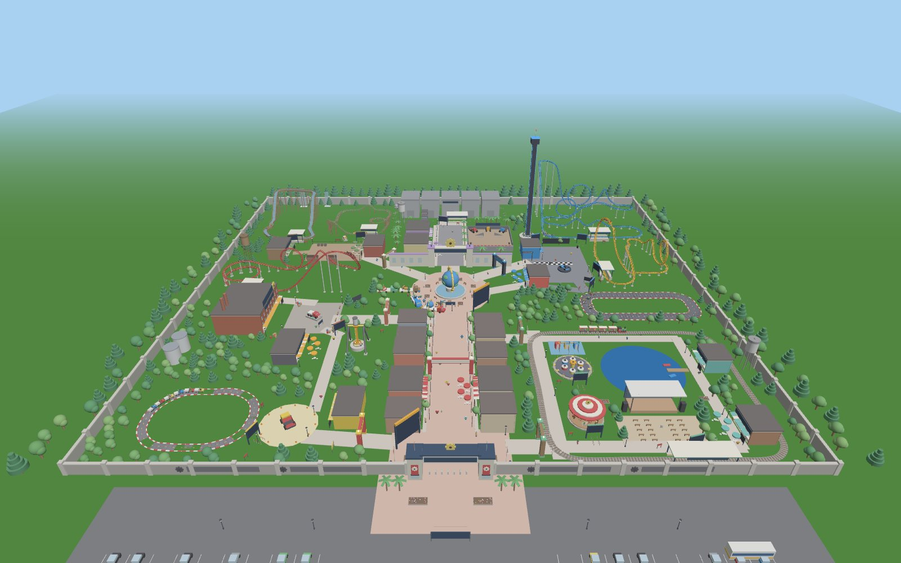

# Benton Diesel World

A Roblox theme park game: seven lands, 13 rides with live wait times, four
shows, seven shops and six restaurants.



*A preview of the park as the game builds it, rendered from the game's own
build code. Terrain, sky, lighting and sign text look much better in Roblox.*

---

## Play it in your browser (no Roblox needed)

The `web/` folder is a browser edition of the same park, built with three.js
from the Roblox game's own build code: same lands, rides, wait times, shows,
shops, restaurants, Benton Bucks and passport. Progress is saved in your
browser.

It is drawn as its own realistic game rather than a copy of the Roblox look:

- **People** are smooth, properly proportioned humans with faces, hair styles
  (short, long, ponytail, buzz cut, caps), shirts, shorts or long pants and
  shoes, in two body builds and many skin tones. You walk, run (hold Shift),
  jump and sit on rides with a real walk cycle; the strolling crowds and the
  guests in every queue line walk, stop to look around and shuffle forward.
- **Materials** are physically based: painted steel, timber and planks,
  concrete, brick, fabric and rubber each get their own procedural surface
  detail, and box edges are softly rounded so light catches them.
- **Light:** an atmospheric sky with drifting clouds, the sun crossing it
  through the day, a moonlit starry night, soft shadows, reflections of the
  sky in metal, glass and water, filmic tone mapping and bloom on neon,
  string lights and signs (plus ambient occlusion on Ultra).
- **Nature:** one smooth terrain with hills, the rocky mountain, a sandy
  lake shore and rolling countryside with woods; broadleaf trees, pines and
  palms that sway in the breeze; blades of grass around you; rippling water
  in the lake and the log flume.
- **Rides** run on smooth swept track: tubular steel coaster rails with
  spines and brackets, a timber mine-coaster track, the flume channel,
  roads and the railway.
- **Graphics settings** (⚙ Settings): Fast for phones, High, and Ultra.
- **Arriving (browser only):** pick where to park on the start screen:
  Regular (free, at the back of the lot), Preferred (B$20) or Deluxe (B$40,
  right by the gate). You start beside your own car. Cars drive in from the
  road all morning, stop at the toll booths and follow coned lanes to their
  tier, with parking attendants in hi-vis vests waving them through; the lot
  fills up as the day goes on. Everyone then walks to the security
  checkpoint: six lanes under an orange-paneled canopy, each with a bag
  check table (some with x-ray scanners) and a walk-through metal detector
  that beeps and flashes green as you pass. Officers in white shirts check
  bags and wave you in. ⚙ Settings has **Back to my car**.
- **New park: NATURAL KINGDOM (browser only).** A second park across the
  Benton Parkway, in a valley levelled out of the hills south of the road.
  - **Getting there:** walk over the **Kingdom Bridge**, which climbs from
    the main lot's south end, over the parkway, and down to the gate. Or
    use ✨ Teleport from any of its rides.
  - **Kingdom Gate:** two carved stone towers under a timber beam,
    Kingdom Outfitters (shop) and Sunstone Sweets.
  - **The Sunstone:** at the end of Kingdom Walk, a great sandstone arch
    over a pool, with a waterfall from its crown, animals carved into its
    legs and a gold sun on top. Paths lead out from it to three lands.
  - **Savanna Reach:**
    - **Savanna Trek Safari.** A convoy of two open-air safari trucks takes
      a 1,483-stud dirt road through the savanna, about 2¾ minutes. It
      passes ostriches and giraffes on the plains, zebras, elephants at
      the watering hole (one swings its trunk), a pride of lions on their
      rock, wildebeest, rhinos, and a hippo pool with flamingos, among
      acacias, a baobab and termite mounds.
    - **Cheetah Chase.** A fast family coaster along the savanna's edge, up
      to 59 km/h.
    - **Watering Hole Grill.**
  - **Rainforest Hollow:**
    - **River Safari.** Launches go up a jungle river past crocodiles on
      the bank, monkeys in the trees, a waterfall, temple ruins, a tiger
      on its rock and a family of gorillas.
    - **Canopy Kitchen.**
  - **Primeval Valley:**
    - **Raptor Run.** A coaster with a 31-stud lift, up to 79 km/h, round
      a glowing, smoking volcano, past long-necks, triceratops and raptors.
      At the bottom of the valley a tyrant lunges at the train.
    - **Dig Site Snacks** and the **Amber Trading Post.**
  - **New items:** a Safari Hat, Lion Mane Ears, Raptor and Giraffe
    balloons, Jungle Juice, Savanna Skewers, Dino Nuggets and a Sunstone
    Smoothie.
  - **The park day:** Natural Kingdom keeps the same hours as the main
    park.
    - It has its own guests, coming in through its gate and walking its
      paths, and its own cast door for the crews.
    - Its gate rolls shut overnight, and security walks you out through
      it.
    - Its rides can be in early entry.
  - **Under the hood:** the terrain's detail, the walking map and how far
    you (and the free cam) can go all now reach the new valley. Unseen
    walls now count as walls on the walking map.
- **Change: longer days (browser only).** A park minute now lasts 4 real
  seconds instead of 1, from 7:00 AM to 11:00 PM, so a day takes about an
  hour.
  - The cast's setup and early entry get about 4 minutes each.
  - The park is open for about 52 minutes.
  - Closing to the security walk-out takes about a minute and a half.
  - The night runs 12× faster, about 2½ minutes, or use ⏩ Skip to morning.
  - Show countdowns now say how many park minutes until the show.
- **New: a full park day, with guests who walk to places (browser only).**
  - **The schedule:**
    - **7:00 AM, setup.** Cast members come in through a CAST MEMBERS ONLY
      door beside the front gate and walk to their posts: ride crews, shop
      and restaurant cashiers, cart vendors, greeters, sweepers. Each
      spends a moment setting up. The shops' roll-down shutters go up one
      by one, and the rides run empty test trains.
    - **8:00 AM, early entry.** The front gate rolls open and ten of the
      most popular rides open, a couple from each corner of the park.
      Every other ride has a red CLOSED chain across its entrance and says
      OPENS 9:00 AM. Restaurants are open; shops wait.
    - **9:00 AM, everything opens,** with fireworks over the gate.
    - **9:45 PM:** a 15-minute warning.
    - **10:00 PM, closing.** Every line closes. Guests already in a line,
      you included, still ride, while the back of each line gives up. Each
      ride shuts for the night once it's empty, the chains go back up and
      the shutters come down.
    - **10:22 PM:** security walks anyone still inside out to the front
      gate (not while you're riding or in a line). The gate rolls shut
      until morning, and anyone who slips in overnight gets walked out too.
    - **By 11:00 PM** the cast have walked out through their door.
  - **Guests walk to places.** The old strollers walked back and forth on
    a few walkway lines. Now each guest comes in through the gate, picks a
    ride, restaurant or shop, walks there and goes in. They come back out
    of the ride's exit and pick the next place, then go home after a few.
    - Popular rides draw more guests, and nearby places more than ones
      across the park.
    - The park fills through the morning and thins in the evening, and at
      closing every guest heads for the gate.
    - Out of sight, guests walk faster and simply leave at closing, because
      a park day passes in minutes.
  - **The walking map:** the park is cut into 3-stud cells.
    - It records where you can walk: the terrain, plus paths, plazas, decks
      and steps.
    - It records where you can't: buildings, walls, fences, water, trees,
      coaster track at walking height.
    - Paths are cheaper than lawns, and other rides' queues cost more.
    - The railway is crossed like a level crossing, and the Lower Lot's
      escalators are links of their own.
    - Routes are found with A*, pulled straight where they can be, and
      cached.
  - **By the clock** there's a park status (setup, early entry, open,
    closing, closed). While the park's shut there's a **⏩ Skip to
    morning** button. Ride signs and prompts say when each ride opens. Shops
    and restaurants won't serve you while they're closed.
  - The day now starts at **7:45 AM**, as the cast finish setting up, and
    daytime speed starts at 7:00.
- **Fix: the free cam reaches all of the Lower Lot (browser only).** It
  stopped at z −900, the world's old south edge, so it couldn't fly over
  Neon Gliders, Snowball or Frostbite's south side. Now it reaches the
  cliffs.
- **New ride: Neon Gliders, an indoor suspended family coaster in Neon
  District, down in the Lower Lot (browser only).**
  - **The ride:** you hang beneath a glider edged in neon, two riders side
    by side, feet dangling. The track runs inside a black building on the
    south side of Neon Square:
    - up the lift along the north wall, under a ceiling of stars;
    - a hairpin turn up by the roof;
    - a swoop through the middle and through a spinning ring of light;
    - a U-turn, then back east through a second ring;
    - home along the south wall through a tunnel of neon arches, past a
      neon skyline.
  - **The numbers:** 283 studs of track and about 50 seconds a ride. There
    are 8 gliders with 2 riders each, and the top speed is 49 km/h.
  - **Getting on:** steps go up from the Neon District walkway to the
    entrance and a switchback queue hall. You board from a raised platform
    and leave by the steps down to Neon Square. Inside it's dark, lit only
    by the neon.
  - **To make room:** a food cart, a steam vent and the TONIGHT ONLY
    billboard moved a little north, and the cliff-foot rocks behind the
    building are gone.
- **New: road work on the Benton Parkway by the Grand Hotel (browser
  only).** A new water main is going in along the north verge, east of the
  hotel's car park, between the park's wall and the road. It has:
  - a trench behind jersey barriers;
  - an excavator digging in it, a dump truck loaded with spoil, and a road
    roller by fresh asphalt on the shoulder;
  - a light tower, a site office and an arrow board, with amber beacons
    turning;
  - cones and drums down the shoulder;
  - a crew in hard hats;
  - ROAD WORK AHEAD and END ROAD WORK signs for both directions, and a
    GRAND HOTEL ACCESS OPEN sign.

  Everything stays off the driving lanes, so the traffic and the hotel
  shuttle still get through.
- **Fix: the game runs smoother, and the camera stays level in the Lower Lot
  (browser only).**
  - **Camera:** it never went below ground level (y 0.6). Down in the Lower
    Lot, 36 studs lower, that left it far above you, looking straight down.
    Now it only stays above the ground under it.
  - **Ride riders:** each rider is drawn on its own, and they were drawn
    every frame wherever they were, even off-screen, and again for shadows.
    Now riders out of view aren't drawn, riders more than 320 studs away
    are hidden, and only riders within 140 studs cast shadows.
  - **Far-off ride cars:** cars more than 700 studs away, specks in the
    haze, are hidden.
  - **No more hitch every few seconds:** the sky's reflections were
    re-shading from scratch each time the sun moved a little. That shader
    is now kept.
  - **Draw calls:** spawn went from about 3,070 to 1,250 a frame, the Lower
    Lot pit from 1,820 to 460, and Neon District from 1,620 to 300.
  - **Auto Low:** if you've never picked a graphics setting and the game
    runs under 24 frames a second for 12 seconds, it switches to Low once
    and tells you. You can change it back in ⚙ Settings.
- **Fix: the Lower Lot's escalators go both ways again (browser only).**
  Before this fix you could end up stuck at the bottom:
  - The LOWER LOT arch is centred on the open gap between the two lanes, so
    walking straight through it dropped you to the pit floor.
  - The railings on the terrace and the halfway landing were low enough to
    step over.
  - Strafing or running on an escalator could slide you off its side, or
    across onto the other lane.

  Now:
  - The lane you step on holds you until you get off at its end.
  - Stepping into the gap between the lanes, or onto the edge of the bank,
    puts you on the lane that leaves from that end (DOWN at the top, UP at
    the bottom).
  - A brushed-steel deck fills the gap between the lanes.
  - The railings now stop you.
  - Walk up the middle from the pit floor and you're carried to the landing
    and on up to the terrace.
- **New ride: Snowball, a mine train coaster in Frostbite Base, down in
  the Lower Lot (browser only).**
  - **The setting:** you ride the ore trains of the old Snowball Mine.
    The train is a little green locomotive pulling four rusty ore carts,
    on steel rails over wooden ties and timber trestles.
  - **The ride:** 685 studs of track, about 1 minute 40 seconds, up to 59
    km/h and 17 studs high, with no inversions.
    - Lift 1 climbs along the edge of the base.
    - A drop down the west side, then bunny hops along the foot of the
      cliffs.
    - Lift 2, then over the brake run with about 11 studs to spare.
    - Hills along the snowy mountain, past the mine entrance and its ice
      crystals, and through the ice cave.
    - **The avalanche:** as the train runs along the mountain's foot, the
      giant snowball breaks loose and comes rolling down its slope at you
      in a burst of snow.
  - **The depot:** a timber shed with snow on the roof, icicles, the
    SNOWBALL sign and a giant snowball on top.
    - The line runs in from the base's east-west path, and the exit
      comes out beside it.
- **The Lower Lot (browser only): a whole new level of the park, 36 studs
  down, with three new lands.**
  - **The ground:** dug out of the mountains south of Zero Space and
    Override. A basin of about 840 × 300 studs is ringed by rock cliffs,
    with rock walls at their foot.
  - **Getting there:** follow the sign from Zero Space's walk to the new
    terrace. It has glass railings, coin binoculars and a gateway lit
    "THE LOWER LOT".
  - **The escalators:** they run down from the terrace in two flights,
    with a landing halfway, into a pit with neon-ribbed concrete walls.
    - Each flight has a down lane and an up lane. Step on and you're
      carried, about 8 seconds a flight, and you can walk too.
    - Guests ride them too.
  - **Neon District:** towers lit with neon (Hotel Nova, Karaoke Zone,
    Night Market, Cyber Cafe, The Grid Tower...) and Neon Square with its
    giant neon ring, holographic billboards and food carts.
    - **Pixel Palace (shop):** neon shades, glow lanterns and neon
      balloons.
    - **Night Market Noodles (food):** ramen, bubble tea (speed) and
      dumplings.
  - **Lost Lagoon:** a lagoon under a waterfall pouring off the cliffs,
    with palms, tiki huts and torches, a dock with a boat, a wreck in the
    shallows and a boardwalk round the water.
    - **Lagoon Shack (food):** fish tacos, coconut coolers (speed) and
      pineapple whip (jump).
  - **Frostbite Base:** a polar research outpost with snowfields,
    snowbanks, ice spikes and a frozen pond. There are station huts, a
    radar dome, a snowcat, the half-buried cargo plane that crashed here,
    penguins and snowy pines.
    - **Cocoa Camp (food):** polar cocoa (speed), icicle slush (jump) and
      snowball cookies.
    - **Expedition Outfitters (shop):** snow goggles, crew caps and
      penguin balloons.
- **Free cam (browser only):** press **C**, or tap the 🎥 button in the
  top bar, and the camera leaves your guest and flies anywhere.
  - **Keyboard:** WASD or the arrow keys fly, Space or E goes up, Q goes
    down, Shift goes faster.
  - **Mouse:** drag to look; the mouse wheel changes your speed.
  - **Phone:** the stick flies, dragging looks, and ▲▼ buttons rise and
    fall.
  - **Your guest stays put.** If they're on a ride they keep riding, and
    in a line they keep shuffling forward with it.
  - **The camera** has no walls to bump into, but it stays above the
    ground and inside the world.
  - **H** hides the rest of the HUD for clean shots, and **P** still takes
    a photo.
  - **C**, **Esc**, the Exit free cam button or the 🎥 button brings the
    camera back. Teleporting also ends free cam.
- **New haunted house: Hollow Mask Universe, inside The Diesel Heist
  (browser only).**
  - **The Diesel Heist is temporarily closed** while it's on, because the
    house uses its whole line. Its signs, its wait board and the app all
    say "TEMPORARILY CLOSED".
  - **The line:** the Heist's chain-rope lanes outside, every row of its
    hall, then up the strip along the hall's west wall.
  - **The walk:** through a new door into the show floor, under the launch
    hill (the track is high overhead), round the empty show floor, back
    under the hill, down past the parked train and the platform, and out
    the Heist's exit.
  - **The rooms:** one for each film in the Hollow Mask series: the roller
    rink, the car wash, the TV station, the hotel, the carnival, the
    laundromat and the mall, where one of the mannequins isn't one.
  - **The killer:** the Hollow Mask is in every room. He wears a cracked
    white porcelain mask with hollow eyes and no mouth, a blood-red
    hooded raincoat, and carries a hooked blade. A copycat fan in a
    cheaper mask turns up too.
  - The haunt now has 11 houses.
  - Hollow Mask is an original killer and franchise. "Ghostface" belongs
    to a real film series, so it isn't used.
- **Summer is over and Benton Haunt is back (browser only):**
  - **Summer ends:** the summer parades and the summer overlays are gone,
    and so is the barricaded walkway through the backstage lot. Sun
    Swinger stays.
  - **The haunt returns:**
    - The houses are back in the backstage soundstages, including Final
      Destination on Stage 6, with Lights Out at Lakeside in the Family
      Landing tent.
    - The seven scare zones and the haunt food are back.
    - Ravage and BLACKLINE are reached by walking across the haunt lot.
    - No scare-zone prop sits on a ride's queue line any more.
  - **New: three houses inside ride buildings.** Each is built into floor
    space its ride doesn't use, with new doors cut into the building, a
    lit front and an outdoor line. The rides keep running beside them.
    - **Siren's Wake: The Drowned Crew:** the storm-lashed deck of the
      Benton Belle, the flooded hold, the crew's quarters and the siren's
      grotto. You meet drowned sailors and a siren with a trident.
    - **Neon Getaway: Dead Drop:** the bank's night vault, the parking
      garage and the motel hideout. The masked getaway crew and the
      undead cops who chased them are still there.
    - **Win the Crown: The Baron's Dungeon:** the cells, the armory and
      the executioner's hall under Baron Vex's fortress, with dungeon
      guards and the executioner.
  - The haunt now has 10 houses and 7 scare zones. The signs, billboards,
    bus displays and park posts all say so.
- **Summer overlays (browser only):** for the summer season, six rides
  get a summer makeover.
  - Each one has a new summer name and a ☀ arch over the way in.
  - Decorations fill the space round the entrance, placed automatically
    clear of walls, tracks, queues and paths.
  - Each ride gets new effects: water cannons, summer confetti or
  fireworks.

  | Ride | Summer name | What's new |
  | --- | --- | --- |
  | Jungle Raid | Monsoon Run | Water cannons at the ravine and over the ruins; tiki torches, palms, misting fans, Coconut Coolers stand |
  | Harbor Run | Regatta Week | Nautical bunting, sailboats, life rings, a Snow Cones stand; a soaking off the breakwater |
  | Cyclone | County Fair Twister | Bunting, hay bales, a Lemonade stand, a giant beach ball; a cloudburst |
  | RC Race | Beach Grand Prix | Chequered flags, surfboard racks, beach balls; water cannons on the straights and confetti at the finish |
  | Benton Blitz | Heatwave | Misting fans all along the line, a 103° thermometer, an Ice Pops stand; water cannons |
  | Flying Fire | Firecracker Summer | Bunting, fireworks racks, a Firecracker Pops stand; fireworks bursting over the train |

  A toast tells you when you reach each one.
- **New ride: BLACKLINE: The Last Train, a haunted subway dark ride
  (browser only):** "Your stop disappeared years ago."
  - **Where:** the field south of Ravage. Walk down the east side of
    Ravage's field to the red-and-white gate in its south wall.
  - **The front:** one whole subway station. The station house has
    BLACKLINE across the top and the exit, with the street entrance
    (railings, red globe lamps, turnstiles) beside it.
  - **The line:** down a chain-link passage into a yard of chain-link
    switchbacks beside the black tent, with flickering station signs,
    route maps and crackling speakers. Then a covered walkway and a
    deserted platform hall.
  - **The ride:** slow subway cars on rails, three cars of eight seats.
    - Out past the maintenance yard into a tunnel in the side of the tent.
    - Round the train graveyard.
    - Past Graymoor, an abandoned platform with silhouettes moving
      behind frosted windows.
    - **The blackout:** the train stops in the junction, the lights die,
      and the announcer says "There are no more scheduled stops." Red
      emergency lights show what's left of the line's last conductor
      beside the track.
    - **The escape:** the tunnel comes down, with fans, chasing lights
      and a roar behind you.
    - **The finale:** sparks as you burst out through a ruined tunnel
      mouth into the fenced rail yard, round a wrecked subway car, and
      back to the station.
- **New ride: Jungle Raid, a Mack-style coaster with a holding brake over
  the edge (browser only):**
  - **Where:** a jungle clearing north of Operation: Win the Crown. Walk
    up the east side of the fortress courtyard to the carved stone gate
    with torches in its north wall (or use ✨ Teleport).
  - **The story:** the Benton Explorers' Club has found the lost Temple of
    the Jaguar King (the park's own legend), and you're on the raid for its
    golden idol.
  - **The ride:** explorers' jeeps in jungle green and khaki, with a spare
    tire on the back car, on green track.
    1. Up the lift beside a waterfall pouring off a rock cliff into a pool.
    2. Over the top to the edge, where **the holding brake stops the train
       with the front car hanging nose-down over the drop**, for about 3
       seconds.
    3. Then it lets go: a drop past vertical (about 95°) into the ravine,
       with a splash at the bottom.
    4. A vertical loop round a giant stone jaguar head with glowing gold
       eyes and fangs.
    5. A heartline roll through the stone temple arch, with torches
       flaring.
    6. Airtime hills over the ruins: broken columns and a stepped temple
       with the golden idol on top.
    7. Back to base camp.
    - Top speed is about 97 km/h.
  - **Around it:** a bamboo-and-thatch base-camp station with torches, a
    switchback line between bamboo rails starting at a stone gateway, and
    palms and jungle trees all round.
- **Teleport buttons (browser only):** every ride, show and restaurant in
  the park app now has a ✨ Teleport button next to 📍 Guide.
  - It takes you straight to the ride's entrance (or the show's viewing
    spot, or the restaurant's front), facing it.
  - It's handy now the park runs all the way out to RC Race and Operation:
    Win the Crown.
  - If you're in a line, you step out of it. You can't teleport while
    you're on a ride.
- **New ride: The Diesel Heist, an indoor coaster replacing Diesel Run
  (browser only):**
  - **Where:** Diesel Run's old building, west of Diesel District. The
    closed fence is gone; the gate arch, the facade and the walkway
    signpost now say THE DIESEL HEIST.
  - **The story:** Benton Diesel Works keeps its gold-plated Diesel X-2
    prototype engine in the R&D vault. Tonight you're the crew that breaks
    in for it. The plan on the wall says: 1 trip the alarm, 2 grab the
    X-2, 3 drive out ("step 1 is not part of the plan").
  - **The ride:** black getaway cars with orange stripes and a chrome truck
    grille up front, on orange track, all indoors.
    1. The launch trips the alarm: red beacons, laser beams across, a
       flashing SECURITY BREACH sign, sparks.
    2. A hill up past the R&D vault's swung-open round door and gold glow,
       with an explosion.
    3. A vertical loop.
    4. A heartline roll past hovering security drones.
    5. A helix round the X-2 itself, a gold engine turning on its
       pedestal.
    6. A zero-g roll, with fire.
    7. The brakes, past the getaway truck with its engine running.
    - That's three inversions, and the top speed is about 108 km/h.
  - **The line is extended outside:**
    - It starts at the gate and runs along chain-rope lanes up the
      building's east side (chrome stanchions with red ropes), past WANTED
      posters and lamps.
    - Inside, it runs through six long rows in the old R&D hall, past TOP
      SECRET and X-2 posters, then onto the platform.
  - BentonGram has an opening post.
- **Diesel Run has shut down for good (browser only):**
  - The motion-simulator dark ride west of Diesel District is permanently
    closed. There's no line, no crew, and the X-1 rigs sit still in the
    building.
  - Its gate is fenced off with chain-link panels on yellow barrier feet,
    under a big red sign: DIESEL RUN IS PERMANENTLY CLOSED · THANK YOU FOR
    EVERY TEST DRIVE.
  - Red PERMANENTLY CLOSED banners hang on the gate arch and across the
    building's facade, and its doors are chained shut.
  - The signpost on the walkway, the wait sign and the park's wait-time
    boards all say it's closed, and so do the ride list and the ride
    prompt. The ride list shows CLOSED rather than REFURB, and the prompt
    and the toast say it isn't coming back.
  - BentonGram has a farewell post.
- **New ride: Operation: Win the Crown, an indoor RMC-style coaster on
  T-Rex-style track (browser only):**
  - **Where:** Baron Vex's fortress, north of RC Race. Follow the walk up
    the east side of the raceway to the navy-and-gold gate in its north
    wall.
  - **The story:** Baron Vex (the park's own villain) has stolen the
    Benton Crown and locked it in his fortress. You're the agents sent to
    win it back.
  - **The track:** a new T-Rex style. Flat steel topper rails sit on a
    wide blue flange with a deep T-shaped web underneath, and stiffener
    plates run along it.
  - **The ride**, fully indoors:
    1. Up the lift through a criss-cross of red laser beams.
    2. A twisting first drop past the guard towers' searchlights, with an
       explosion as they spot you.
    3. A **zero-g stall** over the vault: hanging upside down past its
       giant round door and stacks of gold bars, with sparks.
    4. An airtime hill, then a **barrel roll**.
    5. An outward-banked hill, RMC style.
    6. A helix round the throne room, with Baron Vex's empty throne on a
       purple dais.
    7. A **zero-g roll** out under the lift.
    8. Into the brakes past the crown itself on a pedestal under a gold
       light, with a MISSION COMPLETE / YOU WON THE CROWN sign and gold
       confetti.
    - That's three inversions, with a top speed of about 90 km/h.
  - **Outside:**
    - A dark stone fortress with battlements, four corner turrets with
      purple roofs, purple banners, and a giant gold crown over the door.
    - The line winds through a courtyard of hedge switchbacks under
      sweeping searchlights, starting at an AGENTS: ENTER HERE sign.
    - Inside, the mission briefing screen leads you to the black-and-gold
      cars.
- **Easter is over, and summer is here (browser only):**
  - **Easter has packed up:** the Easter Bar, Meet the Easter Bunny,
    Inside the Egg and the Great Benton Egg Hunt are gone. The soundstages
    are clear.
  - **The summer parades:**
    - **Summer Splash Parade**, at 10 AM and 3 PM down Main Street and
      through the Hub. Four floats: a beach party with umbrellas and a
      giant beach ball, an ice-cream cone with three scoops and a cherry,
      a surf wave with a surfboard riding it, and a giant smiling sun.
      Guests dance on each float, dancers walk alongside, and the floats
      splash the crowd every few seconds.
    - **Summer Lights Parade** at 7:30 PM, at dusk: the same floats lit up
      in neon, a little faster, with confetti cannons instead of water.
      It ends before the fireworks.
    - The Big Rig Parade keeps its midday run (12:30). All three are in
      the Shows list with their times.
  - **Temporary barricades to the backstage rides:** the backstage lot is
    closed for the summer, but the middle of its gate is open under a blue
    RIDES THIS WAY banner.
    - A walkway between solid blue-covered barricade panels runs down from
      the gate and west along the avenue to Ravage's gate. It has lights
      and signs naming every ride past it.
    - The rest of the lot stays fenced off, and crew stand at both ends.
  - **New flat ride: Sun Swinger:** a wave swinger on the speed-trials
    ground, north of Speed Breaker's camelback (the walk is up the east
    side, past Speed Breaker).
    - 24 swings hang on chains from a sky-blue canopy crowned with a giant
      smiling sun.
    - The canopy spins up, rises up the tower to 15 m and tilts like a
      wave, and the swings fly out about 14 m from the middle.
    - It has a small switchback line under sun sails.
  - The hotel, the billboards and BentonGram have all switched to summer.
- **Fix (browser only):** with RC Race, the park passed 41 rides, and the
  game stopped loading. The wait-times boards list every ride, and each
  row got too small for the sign text code. The boards now switch to two
  columns once there are more than 24 rides, and the sign text code
  copes with any size of box.
- **New ride: RC Race presented by Crinkle Crunch, a stand-up coaster
  (browser only):**
  - **Where:** the RC raceway north of Speed Breaker. Follow the walk up
    the east side of the speed-trials ground to the gate in its north wall.
  - **The story:** it's the Benton RC Club championship final, and you ride
    the racers: trains built like giant remote-control buggies, with
    wheels, an antenna with a red tip, and orange, blue and lime bodies.
  - **You ride standing up:**
    - Riders stand at back pads on floor plates, in shoulder harnesses.
    - The park's guests ride it standing (some cheering).
    - So do you: on a stand-up ride your character now stands instead of
      sitting.
  - **The ride:**
    1. Up a 40 m lift and down the first drop, with sparks at the bottom.
    2. A vertical loop.
    3. A corkscrew.
    4. An inclined loop.
    5. North up the infield, under the first drop, and into the pits.
    - That's three inversions, and the top speed is about 97 km/h.
  - **Around it:**
    - A race-garage station with a checkered fascia.
    - An infield raceway with a START / FINISH gantry, tire stacks and
      giant RC buggies.
    - A giant RC remote control by the gate.
    - A line of switchbacks.
  - **The sponsor:** it's presented by Crinkle Crunch, a ridged-chip brand
    made up for the park, with giant chip bags around the raceway. A real
    snack brand's name and logo aren't used, the same way other real
    names have been swapped for originals in the park.
- **New ride: Speed Breaker, a strata coaster (browser only):**
  - **Where:** the speed-trials ground north of Harbor Run, through the
    checkered gate in Harbor Run's north wall (the walk starts at the end
    of Harbor Run's exit path).
  - **The story:** Benton Motor Works is out to break the land speed
    record in SB-1, a silver jet-powered record car with a jet nozzle on
    its tail. The record run ends at the top of the Breaker tower.
  - **The ride:**
    1. A drag-racing start light counts down, and the jet fires.
    2. A hydraulic launch takes you to about 186 km/h through a speed trap
       (TRAP SPEED: 190 KM/H) and down red-and-white launch stripes.
    3. Straight up the 128 m top hat, which twists a quarter turn on the
       way up so you go over the top the right way up, at about 15 m/s.
       The crest turns round, and you come straight down with a quarter
       twist back.
    4. Over a 50 m camelback at about 40 m/s (airtime).
    5. Into the brakes, and round into the garage.
  - **The Breaker tower** is a 125 m white lattice tower between the climb
    and the drop. It has a checkered crown, red aircraft lights, and
    SPEED BREAKER down its side, so you can see it from all over the
    west side.
  - **Around it:** a glass-and-steel pit garage for the station,
    switchbacks under checkered flags, a grandstand facing the launch, and
    a checkered entrance arch with the live wait time.
- **New ride: Harbor Run, a robot-arm dark ride (browser only):**
  - **Where:** the old Benton harbor, north of Cyclone, through the
    navy-and-orange gate in Cyclone's north wall.
  - **The story:** it's PORTBOT 9's first night shift. PORTBOT 9 is Benton
    Port's new cargo robot, a four-seat bench on the end of a giant arm.
    A storm rolls in, and the robot makes a run for it through the port.
  - **The ride:** the arm lifts, turns, pushes and tips you through seven
    scenes in the Pier 9 warehouse:
    1. **The container yard:** a container swings at you and rolls you
       onto your side.
    2. **A freighter's engine room:** giant pistons pound, with steam,
       red light and sparks.
    3. **On deck in the storm:** waves, lightning, rain and wind.
    4. **A giant wave** curls over you and tips you onto your back, with
       spray.
    5. **The lighthouse:** its beam sweeps over you.
    6. **The sea serpent** that lives under the pier (the park's own
       creature) lunges up out of the water with a splash.
    7. **Home to the dock**, where the dock master waves you in.
  - **Outside:** a harbor basin with a tugboat, a red-and-white
    lighthouse, container stacks, and a gantry crane over the line.
  - **The line:** switchbacks through the container yard, then inside the
    warehouse up three lanes to PORTBOT 9's dock.
- **New ride: Cyclone, a compact "El Loco"-style coaster with a drop past
  vertical (browser only):**
  - **Where:** a storm-wrecked farm north of Flying Fire. Follow the
    CYCLONE sign up the east side of Flying Fire's clearing to the
    storm-grey gate in its north wall.
  - **The story:** a tornado tore through Benton Ridge Farm, and its funnel
    is still spinning over the fields: a grey whirl of wind with boards,
    hay and a tractor caught up in it, turning while the ride runs.
    Around it are a barn with its walls torn open, a bent windmill, an
    overturned tractor and scattered hay bales and fence boards.
  - **The ride:** two little storm-grey cars with cyan trim, on cyan track.
    1. A **vertical lift**: you climb straight up, lying on your back.
    2. Over the top, and a **beyond-vertical drop**, past straight down
       and tucking back under the crest, with a cloudburst at the bottom.
    3. A **vertical loop**.
    4. A camelback and tight turns round the far end.
    5. A **zero-g roll**, with sparks as you come out.
    6. Home to the barn.
  - **The line:** short, through white fence-rail switchbacks from a
    stand-by gate with the live wait time.
- **New ride: Flying Fire, a wooden coaster that goes upside down (browser
  only):**
  - **Where:** a logging-camp clearing north of the Blitz canyon, west of
    Wolverine. Walk through Ravage's west gate, then through the torch-lit
    timber gate in the canyon's north wall.
  - **The story:** legend in the Benton Ridge logging camp says a firebird
    nests on the ridge. A big firebird (the park's own design: a
    long-necked bird of flame with swept-back wings of crimson, orange and
    gold feathers) perches on the roof of the timber station, Firebird
    Lodge.
  - **The ride:** red six-car trains with flames down their sides.
    - The chain lift is lit with embers and has torches burning at the top.
    - A steep wooden drop from 34 m, with fire at the bottom.
    - **Upside down #1:** a zero-g roll.
    - Two airtime hills up the far side.
    - **Upside down #2:** a barrel roll at the turnaround (fire as you come
      out of it).
    - An S-bend run home that passes under the first drop.
    - It's all on a classic timber structure: 144 bents of posts, ledgers
      and cross braces.
  - **Around it:** a timber-arch entrance with torches and the live wait
    time, a short switchback line with timber rails and torches, stacked
    logs, a fire lookout tower, burned stumps and campfires.
- **New ride: Benton Blitz, a multi-launch coaster that goes backward three
  times (browser only):**
  - **Where:** a new canyon in the old quarry, west of Ravage. Walk past
    Ravage (follow the BENTON BLITZ signs along its exit path) to the
    yellow-and-navy gate in Ravage's west wall. The park now runs further
    west to fit it.
  - **The story:** Benton Storm Chasers HQ has built a coaster that rides
    the lightning.
  - **The ride:** black trains with lightning-yellow trim and electric-blue
    underglow, on electric-blue track. The launches are worked out from
    real physics (gravity, friction, launch motors), so the train truly
    stalls and rolls back:
    1. Launch 1 doesn't make it over the first top hat (about 46 m tall).
       **Backward #1:** you're thrown backward through the station and up
       the rear ramp.
    2. Launch 2 goes higher, but still not over. **Backward #2**, up the
       rear ramp again.
    3. Launch 3 takes you over the top hat, which turns as it drops, then a
       heartline roll and a camelback.
    4. Out on the course, the second top hat sends you back. **Backward
       #3:** the motors push you backward up the camelback.
    5. The last launch takes you over, round a climbing turn, and down the
       rear ramp into the station.
    - Lightning sparks on every launch and every backward push. Top speed
      is about 31 m/s.
  - **The outdoor line:** a field of switchbacks under lightning-yellow
    sails, among storm-chaser trucks, a Doppler radar and a 30 m lightning
    tower.
  - **The indoor line:** Storm Chasers HQ, where three rows wind through
    the Storm Center past storm screens and a glowing storm map.
  - **The pre-show, the storm briefing:** the room takes guests in groups.
    - Between shows the doors open, and a crew member counts each group in
      on a clicker. The running count sits on a small crew-only display by
      the door: the total, this group, and the time to the next group.
    - Everyone else waits at the door. When the show ends, the group goes
      through to the station together.
    - When you walk in yourself, you're counted too, and get the briefing.
- **Ravage now has the busiest line in the park (browser only):** its
  1.7 km queue is built for crowds, and now it gets them.
  - Its wait aims higher than any other ride's, and through the afternoon
    the line fills the whole maze, from the pod dock back almost to the
    checkpoint: about 130 minutes.
  - Each spot in the line is shown as a group of eight guests, so the
    switchback fields, lab corridors and briefing room are packed.
  - The greeters warn you: get there early.
  - (The park can now draw more waiting guests at once, so the other lines
    don't lose any to Ravage's.)
- **New ride: Ravage, a tilt coaster, half outdoors and half in the dark
  (browser only):**
  - **Where:** the field past the back lot. Walk into the backstage lot,
    then through the red-and-black SECTOR R gate in its west wall (a sign
    on the lot points the way).
  - **The story:** Benton BioDynamics keeps Specimen R, the Ravager (the
    park's own creature: armored, six-limbed, with a split jaw and glowing
    spines), in its Sector R containment facility. Tonight the containment
    is failing, and the way out is the facility's transport pods.
  - **Outside:**
    - A concrete facility with hazard stripes, red beacons on the roof, and
      the Ravager's head and claws bursting out of its east wall.
    - A really long line, about 1.7 km. It starts at a security checkpoint
      (with the live wait time and a guard booth), then winds through two
      big fields of switchbacks. You pass quarantine tents, a wrecked
      SPECIMEN TRANSPORT truck torn open from the inside, leaking green
      barrels, floodlight towers with sirens, camouflage shades and
      warning signs.
  - **Inside:**
    - Lab corridors with monitors (HEART RATE 214, CONTAINMENT 31%) and
      windows into the specimen hold.
    - A decontamination room with steam and amber lights.
    - **The pre-show:** the containment briefing room. A young Ravager
      floats in a green tank, red beacons turn, and the briefing screen
      tells you to evacuate by transport pod and not look down.
    - Then the pod dock.
  - **The ride:** armored pods with red eyes and red underglow.
    - You leave through the specimen hold (green tanks, one smashed open,
      claw marks, a sparking power panel), out of the building and up the
      lift.
    - **The tilt:** the pods roll onto a flat piece of track at the top of
      the tower and stop. Then the whole piece tips forward on its hinge
      until you're hanging face down, 80 degrees, over the ground ... holds
      ... and lets go. You drop 32 m to about 25 m/s, with a blast at the
      bottom.
    - Then a zero-g roll, an airtime hill and a swing back inside, where
      the Ravager lunges at you out of its lair (fire!), and the brakes
      home.
  - Once the train has dropped, the piece tips back up for the next one.
- **New ride: Benton Roll, an indoor launched coaster in the dark (browser
  only):**
  - **Where:** north of Benton Flash. Follow the walk up Benton Flash's
    east side to a gate in its north wall.
  - **The story:** Benton Records' house band, the Diesel Kings, are
    playing a sold-out show across town, and you're on the list, if you
    make it in time.
  - **Outside:**
    - A pink-and-teal hall with a giant teal-and-gold guitar on its front,
      its neck reaching over the roofline, a giant record on the corner,
      and a wall of band posters.
    - The open-air line starts at a steel-truss stand-by gateway (with
      Benton Records' red header, the live wait time, STAND-BY and SINGLE
      RIDER signs, and a giant record on top). It then winds through
      chrome-stanchion switchbacks with sagging chains under black
      umbrellas.
  - **The pre-show, inside:** Studio B, the band's recording session. The
    band is on stage with guitar, drums, keys and bass, and a mixing desk
    glows with faders. The screen says the show's across town in 10
    minutes.
  - **The inside line:** a short one, two rows and then a backstage
    corridor of ALL ACCESS and CREW ONLY signs, leads to the loading dock.
  - **The ride:** the tour cars (black and chrome, speakers in every
    headrest, a color of their own underneath) wait at the launch light.
    - The launch takes you to about 23 m/s through rings of pink and teal
      light, into the dark.
    - Then a heartline roll, a dive down the far side, a low run under the
      helix, back over the top of it, and a corkscrew home.
    - All the way, there are speaker stacks, neon (ON AIR, TURN IT UP,
      ENCORE, SOLD OUT), giant records, music notes and spotlights.
- **New ride: Override, a multi-launch coaster (browser only):**
  - **Where:** south of Jungle Run. Take the walk down Jungle Run's west
    edge to a black gate with a red scan bar in its south wall.
  - **The story:** the park's ride computer has taken over. You board in
    Control Room 7, under screens flashing ACCESS DENIED, OVERRIDE
    ACCEPTED and DO NOT RESIST, five black-and-red cars of four.
  - **Three launches,** each a straight lined with red magnetic launch
    fins and rings of red and cyan light:
    - **Launch 1** (to about 30 m/s) fires you straight out of the station,
      up and over a 56-stud top hat past the glowing AI core.
    - After an overbanked turn and a zero-g roll, **launch 2** (36 m/s)
      blasts you through the reactor tunnel into a huge airtime hill.
    - A camelback follows, then **launch 3** (35 m/s) throws you into a
      heartline roll, before the brakes take control back.
  - **The ride:** 1,309 m in about 70 seconds, with sparks at every launch,
    fire at the reactor and an explosion at the top hat.
  - **Around it:** server towers with blinking lights, glowing cables, red
    and cyan lamps, and 56 graphite supports. Everything is placed clear
    of the train's path.
- **New ride: Benton Flash, a single-rail coaster in the RMC Raptor style
  (browser only):**
  - **Where:** west of Construction Runaway. Walk across its plaza to a
    black-and-yellow gate with a lightning bolt in its west wall.
  - **The track and train:** one tall yellow I-beam rail (a new
    single-rail track style) on black supports. Riders sit single file,
    two to a car, six cars to a train, with lap bars.
  - **The ride** (835 m, a little over a minute):
    - a 51-stud lift past the Benton Power Co. substation;
    - a steep first drop turning out of the sky;
    - a long zero-g stall, hanging upside down over a field of Tesla coils
      crackling with blue-white bolts;
    - an overbanked wave turn;
    - two barrel rolls, and the airtime hills home.
    - There are three inversions in all, and sparks at the coils and an
      explosion over the hills.
  - **The station** is the Generator Hall, with humming generators and a
    DANGER: HIGH VOLTAGE board.
  - **Around it:** the substation's transformers, a big lightning-bolt
    sign on a pylon, and yellow and blue lights.
  - **New in the track builder:** two roll shapes, a stall (halfway
    round, held upside down, then the rest) and an overbank (out and
    back).
  - Every support and piece of scenery is placed clear of the train's
    path.
- **New ride: Jungle Run, a river rapids ride (browser only):**
  - **Where:** south of Siren's Wake. Follow the harbor front's walk down
    the west side to a bamboo gate in Siren's Wake's south wall, lit by
    torches.
  - **The line** winds behind bamboo rails to a thatched-roof boathouse
    (River Expeditions), where six climb into each round raft.
  - **The rafts:** bright rubber tubes with six seats facing in. Each one
    bobs and rocks on the water and turns freely its own way (the
    coaster spin, gentler), straightening up again for the dock.
  - **The river** (882 m, about four minutes) is a water channel winding
    through the jungle and the ruins of a lost temple:
    - up the log ramp past a waterwheel;
    - down the rapids past the rocks and the geysers;
    - round the whirlpool's mossy rock island;
    - under a waterfall pouring off a cliff;
    - through the temple cave, under its lintels, past glowing carvings;
    - over the big drop;
    - past basking crocodiles, parrots on perches and a giant stone idol
      with glowing eyes, and back to the boathouse.
  - **Splashes:** at the rapids, the falls, the drop and the geysers. You
    will get wet.
  - **The jungle:** palms and broadleaf trees, broken columns, torches,
    and timber trestles carrying the raised channel. Everything is placed
    clear of the rafts (the waterfall excepted: you go under it).
- **Easter is here (browser only):** Mardi Gras is over, and the nightly
  fireworks are Benton Nights again. Backstage is open under a pastel
  HAPPY EASTER arch with giant painted eggs on the posts and bunting.
  - **The Easter Bar** replaces the Mardi Gras Bar in the yard:
    - pink, mint and butter-yellow stripes;
    - a giant decorated egg where the mask was, and pastel bunting;
    - hot cross buns, giant chocolate eggs, a spring chicken wrap, Carrot
      Patch Shakes (speed boost), Pink Bunny Lemonade (jump boost) and
      Spring Fizz.
  - **Meet the Easter Bunny** replaces the Mardi Gras show in Stage 23,
    with the same line, now behind white picket fences.
    - You go in under a giant egg to a spring garden: a painted sky with a
      rainbow, a flower meadow, an egg tree and a throne of giant eggs.
    - Each group takes the photo bench in front of the Easter Bunny (the
      park's own: white fur, lavender waistcoat, pink ears and a basket of
      eggs).
    - He hops and waves, chicks bob in their nest, eggs bounce on the lawn,
      butterflies circle, a golden egg turns, and pastel confetti pops for
      the photo.
  - **New walkthrough: Inside the Egg: The Easter Egg Experience** on
    Stage 22, run like the Christmas trails. You walk through:
    - the Egg Gallery;
    - the Hatchery (a giant egg cracking open);
    - the Chocolate Egg Factory;
    - the Springtime Meadow (bunnies and butterflies);
    - the Tunnel of Eggs;
    - the Golden Egg.
  - **New: the Great Benton Egg Hunt**, a walk-it-yourself experience.
    - Twelve big painted eggs bob around the backstage yard: by the gate,
      behind the generator, by the trailers, near the Easter Bar and out
      by the soundstages.
    - Walk up to one to collect it in a burst of pastel confetti.
    - Find all twelve for a B$150 prize.
  - The billboards, the shuttle signs and the park's posts all say Happy
    Easter.
- **New ride: Zero Space, a 4th-dimension roller coaster (browser only):**
  - **Where:** the Benton Orbital Launch Facility, south of Fast & Furious
    and Stranger Things. Walk on down the path between them and through
    the warp gate, a ring of purple and cyan light in the old south wall.
  - **The seats** sit on wings either side of the track, two each side,
    and turn head over heels on their own, with six seat inversions a
    ride. Each car's hub and wings are round about the axle, so only the
    seats and riders visibly turn.
  - **The ride** (1,137 m, about 1 minute 50 seconds):
    - lie back facing the sky up the 58-stud lift, past a Benton rocket on
      its launch tower and through rings of light;
    - go face-first down the near-vertical drop and on round in a full
      somersault;
    - flip again through the warp ring at the top of the raven turn;
    - a zero-g roll through the asteroids;
    - airtime hills over the crater field (lean back, pitch forward, lean
      back);
    - a half flip in the turn past the satellite dishes, and a backflip
      home.
  - **The plaza and station:** a launch hangar (Launch Bay 4, with Mission
    Control's console) with a line on neon-railed switchbacks. An original
    Benton astronaut stands on a plinth.
  - **Scenery:** planets on pedestals (including a ringed giant), asteroids,
    craters and lamps all round.
  - **Supports:** 82 white supports.
  - **How it's built:** the seat angle along the track is the ride's flip
    curve (new in the ride animation). Every support and piece of scenery
    is placed outside the tube the turning seats sweep.
- **New ride: Siren's Wake, an indoor inverted water coaster (browser
  only):**
  - **Where:** an old harbor warehouse south of Neon Getaway, through a
    rope-wrapped gate in Neon Getaway's south wall.
  - **The harbor front:**
    - The bow of the wrecked Benton Belle bursts out through the wall,
      with a carved siren figurehead and a torn sail.
    - A red-and-white lighthouse stands on the corner, and its beam sweeps
      the park after dark.
    - Pilings, crates, barrels, lanterns and harbor fog line the front.
  - **The line** winds through the harbor master's office: SIREN SIGHTED
    and STORM WARNING notices, a ship's wheel, glowing portholes and
    rope railings.
  - **Boarding:** you board the Belle's hanging gondolas at Dock 7, under
    masts and sails. They're eight floorless cars of four with
    over-the-shoulder harnesses, and the front car carries a carved
    figurehead.
  - **The ride** (812 m, about 1½ minutes):
    - up the lift through a storm, with clouds, lightning and rain pouring
      down on the train;
    - a plunge into the sirens' lagoon, where riders' feet go into the
      water with a wall of spray, past a carved stone siren with her harp
      and glowing crystals;
    - a zero-g roll over a whirlpool of rings of light on the water;
    - through the broken hull of the Belle, past cannons and treasure, into
      a second splashdown;
    - up through a kelp forest of glowing jellyfish, under the lift's
      crest;
    - past a sea serpent rising out of the pool, straight through a
      waterfall into a third splashdown, and home to the dock.
  - **The water:** the lagoon and the waterfall pool are real water
    surfaces.
  - **How it's built:** like King Mamba, the track is turned over so the
    trains hang beneath it. Indoors it hangs from the roof trusses, with
    100 supports in all.
  - Everything but the waterfall is placed where the trains never pass;
    the waterfall is meant to be ridden through.
- **New ride: King Mamba, an inverted roller coaster (browser only):**
  - **Where:** north of RV Van Run, through a stone gate in RV Van Run's
    north wall, on a cleared, levelled jungle site.
  - **The line:** it starts by walking in through the open jaws of a giant
    stone king mamba, with gold eyes and fangs. Its body coils away
    behind it.
  - It then winds through torch-lit ruins to the Temple of the King,
    where you board.
  - **The trains:** eight floorless cars of four, with over-the-shoulder
    harnesses, hanging beneath the track with your feet dangling.
    - The track is built like any coaster and then turned over: its spine
      runs on top, and the trains hang below.
  - **The ride** (1,047 m, about 1 minute 45 seconds):
    - a 47-stud lift and a twisting first drop to the west;
    - a zero-g roll;
    - a corkscrew down the far side;
    - a roll over the misty temple pool;
    - a low, fast run through the ruins, past a giant snake statue coiled
      round a pillar.
  - **The inversions:** all three turn around the riders' heartline below
    the rails.
  - **The supports:** 98 in all. They're C-shaped (a column beside the
    train and an arm over the top), or rise straight up where the track is
    upside down. Each one, and every ruin, statue, lamp and tree, is placed
    only where the hanging trains never pass.
- **New ride: Neon Getaway: The Port Benton Heist, an indoor spinning
  coaster (browser only):**
  - **Where:** a big pink-and-teal show building south of RV Van Run,
    through a neon gate in RV Van Run's south wall.
  - **Outside:** palms, a pink getaway car with a police cruiser on its
    tail, neon lamps, and a NEON GETAWAY sign across the front. The
    entrance is the columned front of the Port Benton Savings & Loan.
  - **The queue:** it winds through the bank's marble lobby past six
    teller windows, WANTED posters and neon. You board in the Getaway
    Garage.
  - **The cars:** round getaway tubs, four riders back to back.
    - Each car turns freely on its chassis from the top of the lift to the
      brakes. The turns spin it up and friction slows it.
    - Each of the four cars spins its own way: about 10 turns a ride, up
      to about 30 rpm.
    - They lock facing forward again for the station.
  - **The ride** (a 1,238 m track, about 2.5 minutes):
    - past the open vault (gold stacked high, a red laser grid);
    - up the parking garage lift through rings of red and blue police
      lights;
    - round four rows of rooftop hairpins at the top, under a police
      helicopter, in front of the city skyline and the CORAL MOTEL,
      SUNSET PALMS and PORT BENTON signs;
    - a plunge into the swamp (mangroves, an airboat, gators, mist);
    - along Sunset Beach (sand, palms, a lifeguard tower);
    - through the police roadblock (with an explosion);
    - past the marina's yacht with money bags on deck, and back to the
      garage.
  - **Lighting:** LED strips line the track, and show lights follow it
    the whole way.
  - Each piece of scenery is placed only where the spinning cars can't
    touch it.
- **Benton Holidays has closed, there are New Year's fireworks, and Mardi
  Gras is back with a new show (browser only):**
  - **Benton Holidays has closed for the year.** The Christmas trails, the
    snow, the decorations and Santa's Workshop are gone.
  - **New Year's Eve fireworks:** the nightly Benton Nights fireworks
    (9:15 PM) become New Year's Eve Fireworks.
    - On-screen captions count down from 10, and at "HAPPY NEW YEAR!" a
      volley of 28 gold and silver shells goes up at once.
    - Shells then go up about twice as often, with a longer finale.
  - **The Mardi Gras Bar is back,** this time in the backstage yard facing
    the gate. It has the same purple, green and gold tent, giant mask and
    beads, and the same king cake, beignets, po'boys and zero-proof
    Hurricane punch.
    - The backstage gate is open again under a purple and gold
      MARDI GRAS · BACKSTAGE arch hung with beads.
  - **New show: Krewe of Benton: Mardi Gras Spectacular** in Stage 23 (the
    middle soundstage). It has a real line: switchbacks on purple carpet
    in front of the stage under bead strands and lanterns, with a live
    wait time and an entrance sign. Inside, you take a seat in a 32-seat
    tiered grandstand facing a French Quarter street with wrought-iron
    balconies, gas lamps and a LAISSEZ LES BONS TEMPS ROULER proscenium.
    During the 110-second show:
    - the King's float turns on its turntable;
    - the jester's float rolls out to the footlights and back;
    - a gator float snaps its jaws;
    - the big-head brass band bounces along the front, and dancers spin
      on the wings;
    - beads rain down from the fly loft;
    - confetti cannons in purple, green and gold fire for the finale.
  - It runs as a ride, so Express, Front of the Line, the crew and the
    app's wait times all work.
  - The billboards, the shuttle signs and the park's posts all announce
    Mardi Gras and the New Year.
- **Fast & Furious has reopened, with a new inversion and better lights
  (browser only):**
  - **The new inversion:** after the second launch at the docks, the
    track climbs a hump between the stacked containers and the street
    cars roll all the way over in a zero-g roll. The roll turns around
    the riders' heartline, about 21 m/s upside down at the top.
    - It has its own supports: columns from below, hangers from the roof
      trusses while it's upside down, and side arms to columns in between.
    - Each support is placed only where the passing cars can't touch it.
    - A ZERO-G ROLL sign hangs at the end of the docks.
  - **All-new lights:**
    - LED strips run along both sides of the whole track and change
      color with each part of the chase (pink on the main drag, yellow up
      the garage, orange over the roofs, ice blue on the highway, purple
      at the docks, and a rainbow through the roll).
    - Rings of light circle the riders through both launches and all the
      way round the roll.
    - Concert-style lighting rigs of colored cans hang from trusses under
      the warehouse roof.
    - Neon trims the main drag's rooflines.
    - About 40 more show lights follow the track, so the cars are lit
      wherever they are.
  - **Outside:**
    - Colored uplights wash the warehouse front, and its banner now
      reads NOW WITH A ZERO-G ROLL.
    - The arch has chase bulbs and a REOPENED · NEW ZERO-G ROLL banner.
    - The refurbishment hoarding, barricades, scaffolding and crane are
      gone.
  - The line, crew and wait times are back. Walking up gives a "Fast &
    Furious has REOPENED!" message, and the billboards and the park's
    posts announce the reopening.
- **New ride: RV Van Run, and Fast & Furious closed for a refurbishment
  (browser only):**
  - **RV Van Run** is a new indoor motion-simulator ride in Velocity City.
    Walk east across the Construction Runaway plaza and through a log
    campground arch in its east wall into the Benton RV Park &
    Campground. There you'll find:
    - pines, a parked retro motorhome and picnic tables;
    - a lodge-style show building with a fieldstone base, cabin windows,
      a 70s stripe of orange, mustard and brown, and a big RV VAN RUN sign
      over a timber porch.
  - Inside, the line winds through a ranger station:
    - road-condition and wildlife-advisory boards ("BIGFOOT SIGHTED
      (PROBABLY)");
    - LEAVE NO TRACE and DO NOT FEED THE BEARS signs;
    - a wall of license plates from every state;
    - string lights over the rows;
    - a 1974 Benton Cruiser on display at the end of the hall.
  - You board a cream motorhome with orange and mustard stripes (with a
    roof air conditioner, a ladder, headlights and a spare tire) on a
    motion base, just as its handbrake slips. The ride then runs through:
    - the desert highway past a giant roadside dinosaur and a 99¢ gas
      sign, with a tumbleweed rolling by;
    - a red-rock canyon with rocks coming down;
    - Bigfoot's forest, where he steps out of the pines;
    - a thunderstorm on the mountain pass, with a road sign swinging in
      the wind;
    - a wobbly rope bridge over Devil's Gorge as planks fall away;
    - a bear raiding the cooler at a campsite;
    - a runaway plunge down the switchbacks;
    - back at the RV park: "WELCOME BACK, HAPPY CAMPERS".
  - **Fast & Furious is closed for a refurbishment:**
    - The ride is down: no line, no crew, CLOSED FOR REFURBISHMENT on its
      wait sign, and REFURB in the app.
    - A construction hoarding closes the arch in the Velocity City wall,
      with orange-and-white barricades in front of it.
    - Scaffolding with green debris netting climbs the warehouse's front.
    - A mobile crane swings steel up onto the roof, and crews are at work
      on the scaffold, the roof and a scissor lift.
    - The holiday billboards and the park's posts now advertise RV Van Run
      instead.
- **A late Christmas trail: Stranger Things: Christmas in Hawkins (browser
  only):**
  - A new wing has gone up on the north side of the Stranger Things
    building, in the same Hawkins Lab white with a red stripe and Joyce's
    Christmas lights strung all along the roofline. It's reached by a short
    walk off the Mirkwood path.
  - It's a late trail: closed by day and open after dark, from 5:30 PM.
    The app shows OPENS 5:30 PM until then, and you can still join the
    line early. Attractions can now have opening hours like this.
  - Inside, an indoor line winds past Hawkins posters ("MISSING: WILL
    BYERS - FOUND SAFE · MERRY CHRISTMAS") under strings of lights. Then
    the trail runs through four rooms:
    - the Byers' living room, where the alphabet-wall lights spell out
      MERRY XMAS
    - the Hawkins Lab holiday party, with tinsel and SEASON'S GREETINGS
      on the monitors
    - the Upside Down at Christmas, with vines wrapped in blinking lights,
      spores drifting like snow, and a Demogorgon in a Santa hat
    - the Snow Ball, with paper snowflakes, balloons and a disco ball
- **Benton Holidays is open, with new Christmas trails (browser only):**
  - The event is open: the giant Plaza tree is lit, walkway decorations
    and snowmen line the paths, light strands hang over Main Street, it
    snows, Santa roams the park, and Santa's Workshop is open behind the
    festive backstage gate. Every coaster gets Christmas lights now,
    including Wolverine, the Boom Coaster and the other new rides.
  - New this year, Christmas trails: walk-through light trails that run
    like the haunt houses did (a line, posted waits, groups walking
    through, Front of the Line), but all twinkle and no scares:
    - Inside the soundstages:
      - The Northern Lights (Stage 21): aurora ribbons, ice caves,
        polar bears and penguins of light.
      - Santa's Toy Factory (Stage 22): a conveyor of presents, toy
        soldiers, Candy Cane Alley and the wrapping room.
      - The Enchanted Forest of Lights (Stage 24): light trees, glowing
        deer, giant mushrooms and fireflies.
      - Winter Wonderland (Stage 6): a snowflake canopy, a frozen
        skating pond, giant snow globes and Santa's sleigh flying
        overhead.
    - Gingerbread Lane, in the Family Landing show tent: the old lodge
      facade is now a gingerbread house, and inside is a gingerbread
      village, Candy Land and Mrs. Claus' cookie kitchen.
    - The Twinkle Trail, outdoors through the snowy backstage yard:
      arches of lights, a meadow of glowing reindeer, giant ornaments
      and a light tunnel.
  - Each soundstage trail has its name over the door in a portal of
    lights and a red-velvet-rope line on the lawn. A directory at the
    backstage gate lists them all, and the park's feed announces it all.
- **Benton Haunt has ended, and Benton Holidays is being set up (browser
  only):**
  - The haunt is over: the houses (Final Destination included) and all
    seven scare zones are closed, the backstage gate is locked again, and
    crews are tearing down the house facades on the soundstages and the
    Family Landing tent. The Benton Haunt Front of the Line ticket is off
    sale.
  - Christmas is going up, opening November 21. The giant Plaza tree is
    half built: its bottom tiers are up with the first strings of lights
    round them, a yellow mobile crane is lowering the third tier into
    place, and the top tier and the star wait on a flatbed, next to a
    COMING NOVEMBER 21 banner.
  - The first three light strands are strung over Main Street, with a lift
    and a reel of lights at the next one. Along the walkways, every third
    decoration (trees, presents, candy canes, snowmen) is already out, and
    crates of holiday decor wait at the rest.
  - Behind the locked backstage gate, Santa's Workshop is being framed up:
    a slab, timber studs, roof rafters, the first red boards, scaffolding
    and an OPENING NOVEMBER 21 sign.
  - The parkway billboards, the shuttle signs, the Grand's greeting and the
    park's social feed all say it: thanks for screaming, and Benton
    Holidays is coming.
- **More realistic graphics, and more real-world detail (browser only):**
  - Light: stronger sunlight against the sky light, so shadows read the way
    they do outdoors. A clearer, bluer sky, and exposure tuned so pale
    surfaces aren't blown out.
  - Atmosphere: height fog, thick in the low air and thinning with
    altitude, so tall rides and hills rise out of the haze. It glows with
    sunlight when you look toward the sun, and big soft cloud shadows drift
    across the whole park.
  - Clouds: high wispy cirrus over puffy cumulus with shaded bases,
    sunlit tops and silver linings.
  - Surfaces: weathering on every building and ride. Grime blotches break
    up flat colors, dirt and damp darken the bottom of every wall where it
    meets the ground, faint rain streaks run down the walls, and the
    roughness varies. Pale paving is toned down to a real stone albedo.
  - Camera look (High and Ultra): a filmic contrast curve, warm highlights
    and cool shadows (moonlit blue at night), a vignette, slight lens
    fringing toward the corners and fine film grain.
  - The world beyond the park: three ranges of hills and snow-capped
    mountains fade into the haze on every horizon. Flocks of birds wheel
    over the park by day, airliners cross high overhead leaving contrails,
    and flags (the Stars and Stripes, the park flag and the Benton flag)
    ripple on tall poles over the forecourt.
  - Street details: litter and recycling bins, park benches, fire
    hydrants, flower planters and drinking fountains along the edges of
    the paths, with manhole covers and drain grates set into the paving.
    Wooden utility poles strung with sagging power lines line the Benton
    Parkway, and there are two roadside billboards.
  - Fixes: the Boom Coaster's mine-track rails, trestle braces and Boom
    Mountain's timber headers were missing (a geometry bug) and are back.
- **Construction Runaway: a robot-arm ride with an elevator (browser
  only):** north of Throttle Works, through a yellow-and-black I-beam gate
  in its north wall (a path runs up the side of the refinery from the Boom
  Coaster walk). The Benton Tower building site has hoarding, a tower crane
  whose jib slowly swings round, the site office, porta-potties, a mixer
  truck and an excavator; the show building is wrapped in scaffolding and
  debris netting. RIG 3, a four-seat bench on a yellow robot arm, is meant
  to give a gentle site tour and runs away with you. It still lifts,
  tilts, pitches, rolls and pushes you up to the screens, and now does
  bigger moves too: it rolls you right over onto your side to duck the
  wrecking ball, and tips you halfway upside down, flat on your back,
  under a sky screen as a steel beam swings overhead in the excavation pit.
  Then come the jackhammers and the concrete mixer, the welding bay,
  collapsing scaffolding with falling planks, and a burning fuel tanker.
  For the finale the whole rig rides the construction elevator up a hoist
  shaft to the 40th floor, an open concrete deck under the sky (it flips
  you onto your back again to look up), and drops back down another shaft
  to the inspector's office: PASSED (BARELY). Every wall is dressed in
  plywood hoarding, scaffold ribs, pipes, gauges and work lights, and the
  floor between the scenes is piled with cones, rebar, cement bags,
  I-beams, cable drums, barriers and generators. Parties of 12, about 4
  minutes.
- **Benton Boom Coaster: a boom coaster and dark ride (browser only):** a
  runaway mine train east of Throttle Works, through a timber mine portal
  in its east wall. Each car's bogie rides a low, dark steel coaster track
  and carries a curved steel boom up and over to one side, where a rusty
  mine cart (headlamps for eyes, four wooden seats) hangs over a rickety
  wooden mine track on timber trestles. That mine track is just for show,
  so where it's broken the carts seem to jump the gap: over a ravine where
  the BRIDGE OUT sign stands (a wrecked cart lies at the bottom), and over
  the blown-out track in the dynamite store. Outdoors: a lift hill by the
  water tower, a drop into a big turn, the ravine jump, a camelback and a
  swerve. Then into Boom Mountain, a rocky mountain over a dark ride: the
  mine shaft, a crystal cavern, the dynamite store, an underground river
  with a waterfall, and a cave-in, before rolling out into daylight. The
  queue zigzags under a timber shed past ore carts and TNT crates to a mine
  loading platform. 16 riders a train (four carts of four), about 2 1/2
  minutes.
- **Escape Fuel Throttle: a robot-arm dark ride (browser only):** at the
  Throttle Works refinery north of Stranger Things, through a new gate in
  that land's north wall (ESCAPE FUEL THROTTLE in orange, hazard-striped
  barrier arms). The yard has fuel tanks, a burning flare stack, pipe racks,
  drums and a giant throttle lever jammed WIDE OPEN. Benton Diesel's
  experimental THROTTLE engine has stuck at 900%, and you ride a test rig:
  a bench of four seats held out on the end of an orange industrial robot
  arm that rides a track. The arm lifts you, tips you back and pushes you
  right up to wrap-around screens (five glowing panels in an arc) through
  nine scenes: the Throttle core (with a lever slamming back and forth), the
  pump room's pounding pistons, the pipeline, the tank farm (a spinning
  valve wheel and a leak), the flare stacks in a storm, a collapsing
  catwalk with falling debris, the fireball, the exhaust tunnel and out into
  daylight. Nothing is left bare: every wall has panels, ribs, pipes,
  gauges, valves, light strips and hazard bands; the ceiling is trusses,
  pipe runs and work lights; and the floor between the scenes is filled
  with drums, tanks, manifolds, crates and control cabinets. The big indoor
  queue winds through the test hall past briefing screens to the THROTTLE
  engine itself, glowing, its intake fan spinning. Parties of 12, about a
  3-minute ride. Also fixed: on Diesel Run and Stranger Things, the cars
  drove through a scene wall where the track enters the final tunnel.
- **Stranger Things: Escape the Upside Down (browser only):** a second
  motion-simulator dark ride, fully indoors, in the Hawkins National
  Laboratory show building east of Fast & Furious. A new gate in Velocity
  City's east wall (STRANGER THINGS in red) opens onto a path through
  Mirkwood: pines, a HAWKINS sign and a dropped bike with its light still on.
  The very large indoor queue winds through the lab: flickering fluorescent
  tubes, the Byers' Christmas lights strung up the whole corridor, lab
  monitors (SUBJECT 011, GATE STATUS: OPEN), vines across the ceiling and
  Eleven's sensory tank under WELCOME TO HAWKINS LAB. Board a lab containment
  pod (white with a red stripe and a red roof beacon, on a six-legged motion
  base) and ride through the Gate: the Byers' alphabet wall with the lights
  spelling R-U-N as the Demogorgon lunges out, Mirkwood at night with the
  boys' bikes, the Upside Down with Demodogs and drifting spores, the Mind
  Flayer over a red storm, Starcourt Mall (Scoops Ahoy!) as the floor gives
  way, Vecna's grandfather clock swinging, then red and blue rings back
  through the Gate to WELCOME BACK TO HAWKINS. Parties of 12, about a
  3-minute ride.
- **Free Front of the Line for you (browser only):** both Front of the Line
  tickets (rides and Benton Haunt) are now yours from the start, free and
  unlimited, just like your Express Passes. Press G at any ride or house.
- **Diesel Run: a motion-simulator dark ride (browser only):** a new
  high-tech dark ride, fully indoors, in a huge show building on the land
  west of Diesel District.
  - **Getting there:** a new gate in the park's west wall (z ≈ 139), and a
    path from the Diesel District walkway lined with orange lamps.
  - **Outside:** a dark facade with orange light stripes, a giant DIESEL RUN
    sign over the entrance and a live wait sign.
  - **The queue is entirely inside and very large:** a corridor up the east
    wall, then seven switchbacks about 200 studs long through the "R&D
    hall", with blue and orange light strips, pre-run briefing screens, an
    X-1 rig on a turntable and a WELCOME, TEST DRIVERS screen. Guests stand
    in groups of 12 here, so a long wait really fills the hall.
  - **The vehicles:** three Benton Diesel X-1 rigs with 8 seats each and lap
    bars. Each is a cabin (gray, orange edges, window slots) on a
    turntable atop a six-legged hexapod motion base, on a wheeled chassis
    that follows a black rail in the floor.
  - **The motion:** the cabin turns to face each scene and pitches, rolls,
    heaves and drops with the action.
  - **The show (about 3 minutes):** the launch bay countdown; inside a
    diesel engine (giant pistons pumping, a spinning crankshaft, fire);
    Route 9, a desert highway at night; a canyon closing in with boulders
    falling; a storm; a jump over a broken bridge (nose up, then the
    drop); a tunnel of fire; a warp run through rings of light; and the
    finish line ("RUN COMPLETE · 00:59.8 · NEW RECORD").
  - **Exiting:** you leave down an exit corridor.
- **BentonGram: social media in the Benton App (browser only):** a new 📱
  BentonGram tab with a live feed.
  - **The park's account** (@BentonDieselWorld, verified) has a poster for
    every announcement and opening so far, from Benton Haunt and Fast &
    Furious to Wolverine, Final Destination and Front of the Line.
  - **Fan posts** include @coasterkid's two videos.
  - **Guests post live** about what's around them every half minute or so:
    real waits ("Wolverine is at 55 min right now 😩"), walk-ons, the
    Express line, extended queues opening, and haunt posts after dark.
  - **Your photos:** press 📸 Take a photo (or P) to snap the view. It
    writes a caption from where you are (riding, in line, or the land and
    time of day), which you can edit, then post. Likes and comments roll
    in. Your first five posts each visit earn B$5, and a post that hits 100
    likes earns B$20.
  - Tap ♥ to like anything. A badge on the tab counts new posts, and your
    handle and posts are saved between visits.
- **Express lines, extended queues and Front of the Line (browser only):**
  every ride and house now has three ways in.
  - **Standby**, which on a busy day spills into an **extended queue**: a
    rope-and-stanchion switchback on its own paving beyond the end of the
    line, with an "EXTENDED QUEUE · OPENS WHEN BUSY" sign. Twelve rides got
    one (wherever there was room by the entrance), so the headliners'
    lines can now grow past their mazes at peak.
  - **Express** (F) is now a short line of its own: Express guests stand
    beside standby and merge at the front, one Express party boarding with
    every train, so it's a few minutes rather than straight on. Your
    Express Passes are still unlimited.
  - **Front of the Line** (G) is faster still: straight to the gate (or the
    house door) for the very next train or group. Two new all-day tickets
    at the park shops: **Benton Haunt Front of the Line** (B$250, every
    house) and **Ride Front of the Line** (B$350, every ride).

  The ride prompt shows all three (the standby wait, the Express wait and
  the Front of the Line button), the Wait Times tab shows each ride's
  Express wait and when its extended queue is open, the line pill says
  which line you're in, the top bar shows your FOTL tickets, and a new
  billboard advertises Haunt Front of the Line.
- **Final Destination: Death's Design is open (browser only):** Stage 6
  is finished at the east end of the backstage lot (the lot now runs out
  to it), making Benton Haunt 7 houses. Out front: a "Gate 47" facade with
  a departures board over the door ("180 PARIS DELAYED · 23 ROUTE 23
  CANCELLED · 13 YOUR NAME ON TIME"), Flight 180's tail fin, a smoking jet
  engine, a log from Route 23 and caution tape, plus the usual turf
  switchback queue. Inside, seven rooms of Death's design: the Gate 47
  lounge (rain on the windows, "no survivors" on the news), the Flight 180
  cabin tearing open (oxygen masks down, fires in the aisle), Route 23
  (logs rolling overhead, wrecked cars, brake lights), Devil's Flight
  (carnival bulbs, track overhead, cars hanging off it), the Sun Shop
  tanning salon ("max 13 min", timer broken), North Bay Bridge (orange
  girders, cracks in the deck) and the morgue, where Bludworth keeps the
  List. New scare actors: a sooty flight attendant, burned passengers, a
  Route 23 trucker with a chain, a grinning Devil's Flight operator, a
  sunburned tanner in UV goggles, Bludworth with his cane, and Death's
  shadow. It has the longest wait in the haunt; billboards and the
  shuttle wraps now say 7 houses.
- **Benton Haunt is back, with Fortnitemares (browser only):** it's fall
  again. All six houses reopen (the five soundstage houses backstage and
  Lights Out at Lakeside at Family Landing), Graveyard Grub is serving
  again, and the six scare zones return after dark. A seventh zone,
  **Fortnitemares**, takes over Family Landing's southern walkway in purple:
  Cube Monsters, husks and the Cube Queen herself prowl the path; torn-open
  supply drops smoke blue; purple loot llamas stand around (one in three
  has glowing red eyes); half-built walls and ramps, glowing cubes over
  their runes and big cubes floating overhead; a translucent purple Storm
  wall closes in along the edge; the Battle Bus lies crashed on its side
  with its balloon torn, and a Victory Royale banner burns. Wolverine
  stays open (the haunt zones keep clear of its path), Final Destination
  is still under construction on Stage 6, and the Mardi Gras bar has come
  down. Billboards and shuttle wraps advertise 6 houses and 7 scare zones.
- **Final Destination construction (browser only):** work has started on
  next fall's first Benton Haunt house, Final Destination: Death's Design,
  on a brand-new Stage 6 east of the backstage lot. The steel frame is up,
  the back half is clad and roofed, a tower crane is lifting the next roof
  panel, and the first set walls (Gate 47, Flight 180 to Paris) are going
  up inside. Out in the fenced yard the sets are being built: a Volée
  Airlines Flight 180 fuselage on cradles (nose on one end, a torn,
  wire-tangled wreck on the other, tail fin "180" on the ground), a Route 23
  log truck with one log already rolled off, a derailed Devil's Flight
  coaster car, a tanning bed with its lid up, North Bay Bridge girders,
  crates marked "13" and "McKinley", a departures board ("180 PARIS
  DELAYED · 13 YOUR NAME ON TIME") and a site office with "Days without an
  accident: 0". A teaser board by the Velocity City wall, a banner on the
  stage and the billboards announce it.
- **Wolverine is open (browser only):** the new coaster past Backwoods is
  finished. A path leads from the Backwoods plaza, round the south side of
  the Rapids, to a new gate in the west wall under a claw-slashed
  "WOLVERINE · NOW OPEN" arch, with a live wait sign and a greeter. The
  queue's four switchback rows run right beside the launch track, into the
  "Weapon X" bunker station (adamantium tanks, lab lights, hazard
  stripes), where a crew checks the lap bars on a four-car yellow and blue
  train. The ride: a launch to 38 studs/s, straight up and over the 80-stud
  top hat, an overbanked turn, camelback airtime and a swooping turn home
  (about 54 seconds), with sparks off the claws along the way. The
  construction site, cranes and teaser boards are gone, the last holiday
  crates are packed away, and the billboards and shuttle wraps say it's
  open. Express Passes work on it like any ride.
- **Mardi Gras at the Grand (browser only):** a temporary bar by the
  Benton Diesel Grand Hotel's drive: a purple, green and gold striped tent,
  bead strands strung pole to pole, a giant mask with feathers, high-top
  tables with bowls of beads, and a limited-time, all-ages menu: King Cake
  slices, Beignets, Shrimp Po'Boys, zero-proof Hurricane Punch (speed
  boost), Krewe Purple Lemonade (jump boost) and Golden Fizz. Find it in
  the app's Dining tab and walk up to the counter to order.
- **Wolverine is going up (browser only):** past Backwoods' west wall, the
  next coaster is under construction. Its whole circuit is staked out with
  footings; blue supports carry yellow track through the launch, an 80-stud
  top hat and the turn behind it, and a tower crane is lifting the next
  piece into place where the track ends. Further round, the supports are
  part-built, track pieces and steel wait on the ground, the station is a
  red steel frame on its slab, a second crane works by the camelback, and a
  covered car sits on a flatbed ("do not uncover"). A claw-marked
  "WOLVERINE · THE CLAWS ARE OUT · COMING SOON" board stands by the
  Backwoods walkway, more banners hang on the wall, and the billboards and
  shuttle wraps tease it too.
- **The holidays are over (browser only):** Benton Holidays ended January 1
  and everything is coming down: the giant Plaza tree is half gone (its top
  tiers on a flatbed, the star on the ground, a lift and a crew at work),
  crates of holiday decorations wait along the walkways, a lift is taking
  down the last light strand over Main Street, the ride lights, snow and
  Santa are gone, and the backstage is locked again ("Happy New Year! See
  you next holiday season") with Santa's Workshop being packed into a truck.
- **Unlimited Express (browser only):** your Express Pass never runs out
  (🎫 ∞): press F at any ride to skip straight to the front of the line.
  (Set `UNLIMITED_EXPRESS` in `web/src/sim.js` to go back to counted passes.)
- **Benton Holidays, through January 1 (browser only):** the park is
  decked out for Christmas: a giant decorated tree with presents in the
  Plaza and a "Happy Holidays" sign, decorated trees, piles of presents,
  candy canes and snowmen along every walkway, light strands across Main
  Street and snow falling everywhere. Every coaster has strings of
  Christmas lights along both rails that chase in red, green, gold, blue
  and white, and the flat rides have rings of lights. Santa walks the
  park's walkways with his sack of toys and stops to say hello when you come
  near. The backstage gate is open again under a candy-cane arch: the yard
  is snowy, the soundstages have wreaths and a "Happy Holidays" banner, and
  Santa's Workshop is a red cottage with a snowy roof, a smoking chimney, a
  sleigh and reindeer, elves, and a velvet-rope line of families. Walk up
  and press E to meet Santa on his throne: he greets you and has a present
  for you (B$25) the first time. The billboards and shuttle wraps wish
  everyone happy holidays. (Set `CHRISTMAS` in `web/src/season.js` to end
  the event.)
- **Fast & Furious: Benton Street Run, now open (browser only):** walk
  through the new arch in Velocity City's east wall (with a live wait sign)
  into a courtyard queue with shade sails, posters and a hero car on a
  turntable, and board a train of three street cars (orange, blue and
  black, each with a spoiler, wheels and its own underglow) inside a huge
  warehouse where it is always night. The 769-stud, 49-second chase: a
  nitrous launch up the street under a NOS banner, a drift onto a main drag
  of neon storefronts, up the ramps of a parking garage, across a rooftop
  and a jump to the next roof (with an explosion), along an elevated highway
  with a sign gantry and police cars waiting below, a second launch through
  the docks between stacked shipping containers and fire barrels, and home
  through the family garage under a giant neon FAMILY sign. Lap bars, an
  operator and an attendant, posted waits, a passport stamp and Express
  Passes work like every other ride.
- **Benton Haunt has ended (browser only):** the event closed after November 2.
  The houses are coming out of the soundstages: each facade is down to a
  stub, its sign lies face up in the debris, and dumpsters, scissor lifts
  and hard-hat crews are clearing the gutted mazes inside; the queue turf is
  half rolled up and the barricades are stacked on carts. The scare zones
  are gone, Graveyard Grub has closed, and both backstage areas are locked
  behind chain-link gates ("Backstage closed · cast members only"), with the
  Lights Out at Lakeside tent down to its frame. The billboards and shuttle
  wraps now say "Thanks for screaming! Benton Haunt returns next fall."
  (Set `HAUNT_OVER` in `web/src/season.js` to bring the event back.)
- **Hotels and getting around (browser only):** past the lot, the Benton
  Parkway runs by three hotels: the Benton Diesel Grand (a 15-story tower
  with a porte-cochère, a fountain and a pool deck), the Haulers Roadside
  Inn (a two-story motel with a big-rig roadside sign and a neon VACANCY)
  and the Backwoods Lodge (a log lodge with cabins, pines and a campfire).
  Free Benton Shuttle buses, wrapped in Benton Haunt ads, loop the Benton
  Transit Center beside security and all three hotels, keeping right and
  stopping at each stop, where guests wait and climb aboard. Walk up to any
  stop and press E to wait for the next bus (the stop shows when it is
  due, in real minutes), ride it with the other guests and press E at any
  stop to get off. Your car can drive you too: at your car, pick a hotel
  (F changes where) and press E to drive there along the parkway, then
  drive back through the toll plaza into the lot. Cars come and go on the
  parkway, and arriving guests turn off it into the toll plaza.
- **Benton Haunt billboards (browser only):** 16 lit billboards along the
  parkway, the access road and the connector roads advertise Benton Haunt
  and its houses and scare zones, with a glowing moon, a jack-o'-lantern
  or a skull standing out from each board.
- **Overdrive, now open (browser only):** the new coaster beside Diesel
  Thunder. Part of the park's west wall came down and Diesel District now
  runs out onto the hills beyond. Guests come in through a brick arch with
  a live wait sign, wind through the biggest queue in the park (four long
  switchback rows under orange and blue shade sails, with six overflow
  rows chained off for busy days, lamps, oil drums and a 1952 diesel
  engine on display) and board inside Benton Engine Works, an old brick
  engine factory with a sawtooth roof, a gear emblem, a water tower and
  two smoking chimneys. A four-car train with lap bars climbs an 80-stud
  lift, takes a turning first drop, a camelback, a turnaround and a swoop
  over the queue, then brakes back into the station. It works like every
  other ride: posted waits, guests in line, an operator and two attendants
  who check every lap bar, a passport stamp, and you can ride it yourself.
- **Benton Haunt is open (browser only):** the park's Halloween event, with
  6 haunted houses and 6 scare zones, through November 2.
  - *The houses:* walk-through mazes you can join like rides, with posted
    waits, long switchback lines, a passport stamp each and Express Passes.
    Your group walks the dark corridors together through seven themed
    rooms per house, each with its own walls, floor, colored light, fog and
    set dressing (Dead Man's Garage alone goes office, service bay, paint
    booth, junkyard, grease pit, body shop and tow lot). Costumed scare
    actors hide behind cover and lunge across the corridor as you pass. Five
    are in the giant backstage soundstages behind the Studios' back wall
    (Dead Man's Garage, The Lost Miners of Backwoods Hollow, Final Cut: A
    Hollywood Horror, Crash Test and Engine Works: Meltdown), each with a
    lit, fogged facade and a turf queue behind black "Benton Haunt"
    barricades; the sixth, Lights Out at Lakeside, is in a big white tent in
    the Family Landing backstage, with a rope-and-stanchion queue.
  - *Scare zones:* Midnight at the Gate, Smokestack Alley, Scarecrow
    Crossing, The Hollow Woods, Backlot Bloodbath and Burnout Boulevard,
    one in each land. Each one takes over a whole walkway, with arches at
    both ends, its own ground, fog machines and colored lights, and is
    packed with props on both sides: headstones, iron fences and a mausoleum;
    smokestacks, fire barrels and pipes; corn rows, hay bales and pumpkins;
    a forest of dead trees and a stone altar; film lights, blood barrels
    and a motel facade; burning wrecks and tire stacks.
  - *Scare actors:* 19 costumes on the full animated character rig, each
    with its own mask or face, glowing eyes and props: reapers with
    scythes, ghouls, gas masks, scarecrows with pitchforks, pumpkin heads,
    antlered wendigos, lantern wraiths, chainsaw racers, a hockey-masked
    slasher, a megaphone director, crash test dummies, welders, miners with
    lit helmets and pickaxes, and more. In the zones they prowl, stalk you
    when you come near and lunge with a shriek and a line; in the houses
    they burst out from cover.
  - *New food:* Graveyard Grub, on the backstage avenue: Monster Burger,
    Pumpkin Spice Churro, Witch's Brew Slushie (jump boost), Graveyard Dirt
    Cup, Bloody Funnel Cake and Haunted Hot Cocoa (speed boost).
- **Studio Backlot Tram Tour reopened (browser only):** after its
  refurbishment the road is repaved, and at the back of the lot the tram
  now rolls under a row of red-and-white striped tents where it is
  Hollywood inside: the hills and the big white letters, the Walk of Fame,
  the Grand Benton Theatre with a world premiere on a red carpet (its
  flashbulbs pop as the tram goes by), palms, a movie camera and lights,
  director's chairs, a golden statue and strings of lights.
- **Real wait times (browser only):** posted waits are real minutes: a
  45 minute wait is 45 minutes of standing in line (an Express Pass skips
  it). Each spot in line is a party that fills one train (a group of four
  for the haunted houses), so the line moves up one spot every dispatch,
  and a long wait means a long line: the posted time is worked out from
  the parties actually ahead of you, the cycle time and any breakdown
  still being fixed, shown to the exact minute ("No wait" when you'd walk
  right on). The app also shows how long the last guest to board actually
  waited, and guests who give up only ever leave from behind you.

```bash
npm install
npm run export-web   # export the park from the Roblox build to web/public/park.json
npm run build-web    # bundle web/dist (index.html, game.js, park.json)
npm run serve-web    # open http://localhost:8080
```

Controls: WASD or arrows to walk, hold Shift to run, drag to look, wheel to
zoom, Space to jump, E to join a line or open a shop, F for the Express line,
G for Front of the Line (with a ticket), P to take a photo for BentonGram,
1–3 to eat. On a phone, use your left thumb to walk (push all the way to run)
and drag anywhere else to look.

**Sound.** The browser edition makes all of its sound itself, with the Web
Audio API (no audio files):

- **Music for every land** that crossfades as you walk: a Main Street rag in
  Benton Plaza, garage blues in Diesel District, a toy-box tune in Little
  Haulers, bluegrass banjo in Backwoods Junction, big-band swing at the Movie
  Studios, synthwave in Velocity City and a lakeside waltz in Family Landing.
  It plays softer at night, and quieter while you ride or watch a show.
- **Rides:** coaster rumble, lift-hill chain clatter and riders screaming on
  the drops; the steam train's whistle and chuffs; kart and truck engines;
  the drop tower; the log flume splash; the carousel's band organ; boarding
  bells and the dispatch hiss.
- **Shows:** a song with a synthesized singing voice at Big Dreams Live!, stunt-show explosions
  and cheering crowds, a marching band that moves with the parade, and
  fireworks whistles, booms and crackles.
- **Ambience:** crowd chatter, birds by day, crickets at night, the Hub
  fountain, the lake and waterfalls, steam vents and campfires.
- **An announcer** (your browser's text-to-speech voice) for boarding, show
  starts and the stunt show.
- Mute with 🔊 in the top bar; set music and effects volume, or turn the
  announcer off, in ⚙ Settings.

## Play it in Roblox Studio

1. Download **[`BentonDieselWorld.rbxlx`](BentonDieselWorld.rbxlx)** from this
   folder.
2. Open **Roblox Studio** → **File → Open from File…** → pick
   `BentonDieselWorld.rbxlx`.
3. Press **Play** (F5).

The whole park is built by code when the game starts (about 2–3 seconds), so
in edit mode you'll only see a "Press PLAY" sign. That's normal. You spawn in
the parking lot at the front gate.

To publish it: **File → Publish to Roblox**. For saved progress (Benton Bucks,
souvenirs, passport stamps) in a published game, turn on **Game Settings →
Security → Enable Studio Access to API Services**. That also lets you test
saving in Studio.

## How to play

| Do this | How |
|---|---|
| Ride a ride | Walk up to the ride's entrance sign and press **E** (*Join Line*). Your guest walks into the queue and moves up with the line; you can also steer yourself. Walking out of the queue leaves the line. When it's your turn you're seated at the boarding gate. |
| Skip the line | Press **F** at an entrance for the short **Express line** (Express Passes are unlimited), or **G** for **Front of the Line**: straight to the next train or house group, with a Ride or Benton Haunt Front of the Line ticket from the shops. |
| Check wait times | Use the **Wait Times** tab in the app (left side of the screen), or the big boards at the front gate and the Hub. |
| Get directions | Press **Guide me** on any ride, show or restaurant, or tap it on the **Map** tab. A glowing path leads you there. |
| Shop or eat | Press **E** at a shop or restaurant counter. Food goes in your backpack; click to take a bite. |
| See a show | Check the **Shows** tab for showtimes and stand in the audience area while it plays. |
| Wear souvenirs | Open **My Bag** to put on or take off hats, shades and balloons. |

**Benton Bucks (B$)** are earned by riding (+15, plus +35 for a new passport
stamp), finishing every ride in a land (+150), watching a show (+30), a daily
visit bonus (+100), and playing time (+10 every 2 minutes).

**Hunger** slowly goes down. When it reaches zero you walk slower, so eat
something. Coffee and the Turbo Shake give a speed boost, and Nitro Soda gives
a super jump.

### Park time and wait times

The park has its own clock (top bar). During the day, **one real second is one
park minute**, and night passes four times faster. Posted wait times, though,
are **real minutes** (see "Real wait times" above): a 25 min wait is 25 minutes
in line, unless you use an Express Pass.

Every ride has a real queue line: a railed switchback maze by its entrance
sign, ending at a boarding gate. You stand in it alongside simulated guests,
and every guest in line is a real rider who boards the vehicles ahead of you,
so the posted wait matches the line you see. Each maze holds at least an hour
and a half of guests (up to about three hours), and longer lines spill out
past the sign. Waits are longest in the afternoon, when the big coasters
reach an hour or more. Rides sometimes go down for a minute
("Temporarily Closed"), and evenings are quieter.

Because a ride cycle takes 25–70 park minutes, an hour's wait is one or two
trainloads of guests: about 8–28 people in line, depending on the ride.

## What's in the park

Laid out like the concept map: front gate and parking lot at the south,
Main Street up to the Benton Globe fountain at the Hub, and the lands around
it.

| Land | Rides | Food & shops |
|---|---|---|
| **Benton Plaza** | – | Main Street Bakery, Main Gate Emporium |
| **Diesel District** | **Diesel Thunder** (steel coaster: loop and 540° helix), **Piston Pounder** (giant pendulum) | Fuel Up Canteen, Benton Garage Outfitters |
| **Little Haulers** | **Little Haulers Truck Trek** (kids' big rigs) | Little Haulers Toy Garage |
| **Backwoods Junction** | **Backwoods Rapids** (log flume, 40-stud drop), **Runaway Tow Truck** (family coaster) | The Pork Chop Diner, Tow & Repair Trading Post |
| **Benton Movie Studios** | **Studio Backlot Tram Tour** (fire, flood and explosion effects) | Studio Commissary, Studio Store |
| **Velocity City** | **Velocity Viper** (100-stud drop, two loops, zero-g roll), **Nitro Loop** (launch coaster), **Benton Tower Drop** (150-stud drop tower), **Velocity Speedway** (8-kart race) | Pit Stop Pizza, Victory Lane Gear |
| **Benton Family Landing** | **Lakeside Express** (steam train around the land), **Gearwheel Carousel**, **Spinning Pistons** (spinning cups) | The Depot Grill, Lakeside Gifts |

**Theming.** Every land is dressed with props placed by a search of the
built park for clear ground near the walkways: popcorn and balloon carts, a
vintage gas pump and string lights over Main Street; containers, a tower
crane, pipe runs, oil drums and steam vents in Diesel District; a toy digger,
letter blocks, cones and road signs in Little Haulers; a windmill, campfires,
log piles, lanterns and festoon lights in Backwoods Junction; searchlights, a
giant clapperboard, film reels, cameras, a red carpet and a walk of fame at
the Movie Studios; spinning show cars, a podium, tire barriers and neon in
Velocity City; and a lighthouse, a gazebo, rowboats, picnics and beach
umbrellas at Family Landing. The windmill, gears, film reels, show cars and
lighthouse lamp turn, and the searchlights and lighthouse beam light up at
night.

**Staff.** Every ride has a crew in a polo in its land's color, with a name
badge. The operator works a control console (buttons, a screen and a
green/amber/red stack light) at the front of the loading platform. When a
train boards, riders pull their own lap bars or shoulder harnesses down, then
one or two attendants walk the platform car by car, bend over each row and
push every restraint down until it locks. They give the operator a thumbs
up, the operator calls "Clear!" and hits dispatch, and the attendants wave
the train off. The restraints lift again when it comes back. Coasters and the
spinning cups have lap bars, the drop tower and Piston Pounder have shoulder
harnesses, and the trucks and karts have seatbelts that get checked. When
you ride, press **E** (or tap the button) to pull your own lap bar down, or
an attendant will do it for you. Cashiers work every shop and restaurant
counter, greeters welcome you at the gate, vendors run the popcorn and
balloon carts, and sweepers keep the walkways clean. They all wave and say
hello as you pass, in speech bubbles over their heads. Boarding takes 12
seconds so the crew has time to check every row.

**Shows** (times are park time):

- **Big Dreams Live!** at the Lakeside Stage: dancers, stage lights, lake
  fountains and confetti. 10 AM, 12, 2, 4, 6 and 8 PM.
- **Diesel Stunt Spectacular** at the Backlot Stunt Arena: ramp jumps, a
  barrel roll, explosions and a wall of fire. 11 AM, 1, 3, 5 and 7 PM.
- **Big Rig Parade** around the Hub and down Main Street. 12:30 and 5:30 PM.
- **Benton Nights Fireworks** over the Benton Globe and Movie Studios.
  9:15 PM.

To start a show right away while testing in Studio: during Play, select
**ServerScriptService → BentonServer** and add a string attribute
**`StartShow`** set to `BigDreams`, `StuntSpectacular`, `BigRigParade` or
`BentonNights`. A string attribute **`CloseRide`** set to a ride id (for
example `DieselThunder`) closes that ride for 90 seconds.

## Changing the park

Everything is plain Luau in [`src/`](src):

| File | What it controls |
|---|---|
| `src/shared/Config.luau` | Lands, rides (positions, base wait, colors), shows and showtimes, shops and restaurants, economy and hunger numbers |
| `src/shared/Items.luau` | Every souvenir and menu item: names, prices, boosts |
| `src/shared/Layouts.luau` | Coaster and track layouts (control points, lift hills, launches, brakes) |
| `src/shared/Clock.luau` | Park hours and crowd curve |
| `src/server/Build/*` | The park's buildings and scenery, one file per area |
| `src/server/Build/Theming.luau` | Themed props for each land: what each prop looks like and where it stands |
| `src/shared/Sounds.luau` | Music and sound slots for the Roblox version (see below) |
| `src/shared/QueueLine.luau` | Where each ride's queue maze sits, its size, and the path guests stand along |
| `src/server/RideService.luau` | Queues, simulated guests, wait times, dispatching |
| `src/client/App.luau` | The on-screen Benton App |

There are no uploaded meshes, images or sounds. Everything is built from
parts, so nothing can break from missing assets.

**Sound in Roblox.** Roblox can only play audio from asset ids, so the
Roblox version uses a few sounds that come with every Roblox client (button
clicks, reward pings, the flume splash, firework launches; explosions make
their own sound). Music, show music, ride loops and screams are empty slots
in [`src/shared/Sounds.luau`](src/shared/Sounds.luau): paste in the ids of
audio you own or public audio from the Creator Store
(`"rbxassetid://123456"`) and each one plays in the right place. Land music
crossfades as you walk, show music plays at the venues, ride loops play on
the lead vehicle while the ride runs, and screams play on big drops.

### Working with Rojo (optional, for developers)

The folder is a [Rojo](https://rojo.space) project:

```bash
rojo serve          # live-sync src/ into an open Studio place
rojo build -o BentonDieselWorld.rbxlx
```

### Checks without Roblox

```bash
npm install
npm run check       # Luau type-check of every script against the Roblox API
npm test            # runs the real game scripts in a simulated Roblox and plays a guest's day
npm run build       # rebuilds BentonDieselWorld.rbxlx (needs rojo)
npm run build-web   # bundles the browser edition into web/dist
```

`npm test` boots the server, builds the park, and walks a guest through
queueing, riding, buying a hat and a coffee, eating, every app tab and the
shows. It also simulates four park hours. Every class, property, enum and
method it touches is validated against Roblox's official API dump
(`tools/mock`). `node tools/tracks.mjs` prints each ride's length, cycle
time, top speed and g-forces.

## Notes

- Ride vehicles and shows are animated on each player's screen in sync with
  the server clock, so they stay smooth for everyone. Riders are held in
  place by the server and moved with the car on every screen.
- Built for Workspace `StreamingEnabled = false` (set in the place file).
- Original fan creation; not affiliated with any real company or park.
